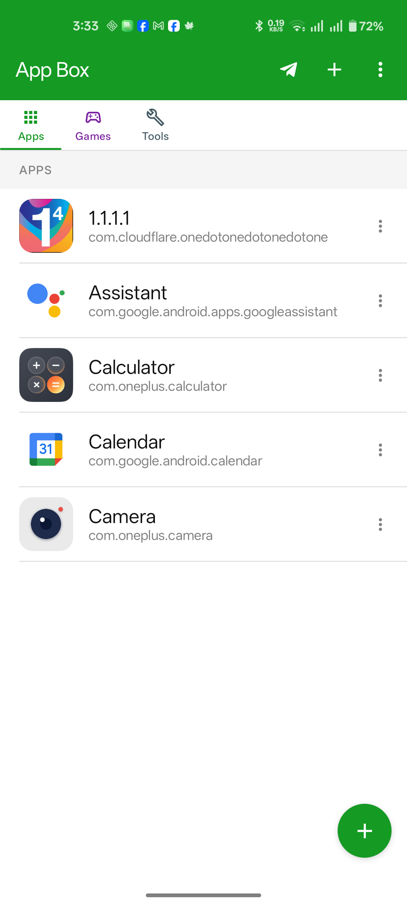

# 📦 AppBox — Android App Launcher

<p align="center">
  <b>A clean, list-style Android launcher inspired by Greenify.</b><br/>
  Organise your installed apps into custom categories and sections without bloating your home screen.
</p>

<p align="center">
  
  
  
  
  
</p>

---

## 📱 Screenshots

<p align="center">
  
  
  
  
</p>

<p align="center">
  <sub>Main Screen · Add Apps · Manage Sections · Settings</sub>
</p>

---

## ✨ Features

- **Categorized Sections (Tabs):** Organise installed applications into default or custom tabs such as *Apps*, *Games*, *Social Media*, *Tools*, *Media*, and *Creative*.
- **Safe App Removal:** Removing an app from a section only clears its shortcut from that section—it **never uninstalls** the app from your device.
- **Fast Multi-Select & Search:** Easily search through installed apps and add multiple apps to any section in one tap.
- **Drag & Drop Section Management:** Reorder, edit, hide, set defaults, or batch-delete sections effortlessly.
- **Gesture Support:** Swipe left/right over the app list to quickly switch between sections.
- **Flexible Sorting:** Sort apps alphabetically (A–Z / Z–A) or by installation/update time.
- **Customization & Themes:** Material 3 design with light, dark, and system theme options.
- **Performance Optimized:** App icons are fetched on-demand directly from `PackageManager` via a byte-bounded LRU cache.

---

## 🏗️ Architecture

AppBox is built with modern Android development practices adhering to **Clean Architecture** principles and **Unidirectional Data Flow (UDF)**:

```text
UI (Jetpack Compose) ──► UiEvent ──► ViewModel ──► UseCase ──► Repository ──► Room / PackageManager
                                        │                                           │
                                        └─────────── StateFlow<UiState> ◄───────────┘
```

### Project Structure

- **`data/`**: Room database (`AppDatabase`), Entities, DAOs, `DataStore` settings repository, and `InstalledAppsRepository`.
- **`domain/`**: Use cases for section management, app sorting, name validation, and app memberships.
- **`ui/`**: Declarative UI built entirely in **Jetpack Compose** (M3), organized into screen states, sealed UI events, and custom composable components.
- **`di/`**: Lightweight manual dependency injection container (`AppContainer`).

---

## 🛠️ Requirements & Tech Stack

| Component | Version / Details |
|---|---|
| Minimum Android | Android 7.0 (API 24) |
| Target SDK | 35 |
| Compile SDK | 37 |
| Language | Kotlin 2.2.10 |
| UI Framework | Jetpack Compose |
| Compose BOM | 2026.02.01 |
| Database | Room 2.8.5 |
| Build Tool | Gradle 9.6.0 |
| Android Gradle Plugin | AGP 9.4.1 |
| JDK | 21+ |

---

## 🚀 Getting Started

### Prerequisites

- Android Studio Ladybug or newer
- JDK 21+
- Android SDK Platform 37
- Git

### Building from Source

**1. Clone the repository**

```bash
git clone https://github.com/iamacat/AppBox.git
cd AppBox
```

**2. Build Debug APK**

```bash
./gradlew :app:assembleDebug
```

**3. Install on connected device / emulator**

```bash
adb install -r app/build/outputs/apk/debug/app-debug.apk
```

**4. Launch the application**

```bash
adb shell monkey -p com.iamacat.appbox 1
```

The generated APK will be available at:

```text
app/build/outputs/apk/debug/app-debug.apk
```

---

## 🧪 Testing

Run unit tests covering use cases, section name validation, and sorting logic against in-memory fake DAOs:

```bash
./gradlew :app:testDebugUnitTest
```

---

## 🗺️ Navigation & Controls

| Action | Description |
|---|---|
| Top Bar `+` | Quick-select or create new sections |
| Horizontal Swipe | Swipe left or right across the app list to switch active sections |
| FAB `+` | Open the multi-select app picker for the active section |
| Row Long-Press / `⋮` | Context menu to Launch App, Move/Copy to another section, Remove, or view App Info |
| Overflow Menu `⋮` | Manage Sections, Sort Apps, Refresh App List, Settings, and About dialog |

---

## 📁 Screenshots Directory

Make sure your repository has this structure:

```text
AppBox/
├── README.md
├── screenshots/
│   ├── main_screen.png
│   ├── add_apps.png
│   ├── manage_sections.png
│   └── settings.png
├── app/
├── build.gradle.kts
└── settings.gradle.kts
```

**Important:** GitHub filenames are case-sensitive. The screenshot filenames in the README must match the actual files exactly.

---

## 📄 License

Copyright 2026 iamacat

Licensed under the Apache License, Version 2.0.

You may obtain a copy of the License at:

https://www.apache.org/licenses/LICENSE-2.0

Unless required by applicable law or agreed to in writing, software distributed under this License is distributed on an "AS IS" BASIS, WITHOUT WARRANTIES OR CONDITIONS OF ANY KIND, either express or implied.

